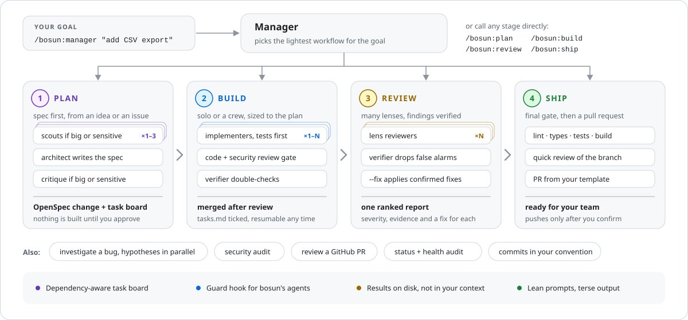

# bosun: your AI dev crew for Claude Code

[](https://github.com/AnwarHossainSR/bosun/actions/workflows/ci.yml) [](LICENSE)

On a ship, the bosun runs the deck crew. **bosun** runs a crew of Claude Code agents for you: give it a goal, and a manager picks the lightest workflow, then specialist agents plan, build, review and ship it in parallel, with a review gate on every change.

<p align="center">
  
</p>

## Why bosun

- **One command for any goal.** `/bosun:manager <goal>` routes features, bugs, refactors, migrations, reviews and audits to the right workflow, and handles small changes without a crew.
- **Spec-driven plans.** Plans are [OpenSpec](https://github.com/Fission-AI/OpenSpec) changes: requirements with testable scenarios, a design and a checklist. Every task traces back to the requirements it implements, and nothing is built until you approve.
- **Parallel builds that stay safe.** A task board schedules work by dependencies and file ownership. Each implementer works in its own git worktree, and every task passes a code review (plus a security review when it matters) before it's merged.
- **Findings you can trust.** Reviewers look through different lenses in parallel, and a verifier re-checks every serious finding before you see it.
- **Lean on tokens.** About 1.3k tokens of always-on context. Agents fetch their own briefs, results go to disk instead of the manager's context, and long logs are read from the tail.
- **Guard rails built in.** A hook stops bosun's agents from pushing, publishing, rewriting history or editing protected paths. Your own session is never touched.

## Quick start

You need Claude Code with plugin support, git, Python 3.10+ as `python3`, and the GitHub CLI (`gh`) for PR features. The [OpenSpec CLI](https://github.com/Fission-AI/OpenSpec) is optional; `/bosun:archive` uses it.

```bash
claude plugin marketplace add AnwarHossainSR/bosun
claude plugin install bosun@bosun-marketplace
```

Then, in Claude Code inside your project:

```text
/bosun:setup                              one-time: detects your commands, writes .bosun/config.json
/bosun:plan add CSV export to reports     spec and task board for your approval (or /bosun:plan #123)
/bosun:build                              parallel agents build the approved plan
/bosun:review                             multi-lens review of the branch
/bosun:ship                               final checks, push and pull request (asks first)
```

Not sure which command fits? `/bosun:manager <goal in plain words>` picks one for you.

<details>
<summary><b>More install options:</b> one project, your team, cloud sessions, updates</summary>

- **One project, just for you:** run the install inside the project with `--scope local`.
- **Your team:** run both commands with `--scope project` and commit `.claude/settings.json`. A teammate who doesn't see bosun runs the install command once.
- **Claude Code on the web:** install inside the cloud container, for example from the environment's setup script (both commands are safe to run again).
- **Try it without installing:** `claude --plugin-dir /path/to/bosun/plugins/bosun`.
- **Check it loaded:** `claude plugin details bosun` lists 12 skills, 10 agents and 3 hooks.
- **Update:** `claude plugin marketplace update bosun-marketplace`, then `claude plugin update bosun@bosun-marketplace` with the scope you installed (`--scope local` or `--scope project`; some Claude Code versions update only user scope otherwise), then start a new session. [CHANGELOG.md](CHANGELOG.md) has the release notes.

</details>

## Commands

| Command | What it does |
|---|---|
| `/bosun:manager <goal>` | Routes any goal to the lightest workflow, from a single agent to a full crew. |
| `/bosun:plan <idea \| #issue>` | Clarifying questions, parallel scouts, an OpenSpec change and task board, critique, your approval. `--classic` writes a PLAN.md instead. |
| `/bosun:build [plan]` | Runs the board with parallel agents in worktrees, a review gate per task, merges and resume (`--resume`, `--parallel N`, `--dry-run`). |
| `/bosun:status [--audit]` | Progress, work in flight, blocked tasks, what's next; `--audit` adds a health check. |
| `/bosun:review [target]` | Parallel lens review of the branch, staged or working changes, a range or a commit; `--fix` applies confirmed fixes. |
| `/bosun:review-pr <n \| url>` | The same panel on a GitHub PR, in a separate worktree; posts only text you approve. |
| `/bosun:investigate <symptom>` | Competing hypotheses tested in parallel, a verified root cause and a report; `--fix` fixes it test-first. |
| `/bosun:security-audit [--full]` | Attack-surface map, your installed scanners, reviewers per area, verified findings. |
| `/bosun:commit` | Logical commits in your convention, checked for secrets and leftovers. |
| `/bosun:ship` | Final gate, push and a PR from your template. Runs when you type it. |
| `/bosun:archive [id]` | Merges a finished OpenSpec change into the main specs. Runs when you type it. |
| `/bosun:setup` | One-time project setup. Runs when you type it. |

You can also call an agent directly: "use the bosun:security-reviewer agent on src/auth".

## The crew

| Agent | Does | Writes |
|---|---|---|
| `architect` | specs, plans, plan critique | plan and spec files |
| `scout` | maps code, answers research spikes | nothing |
| `implementer` | one task end to end: tests, code, checks, commit | code |
| `test-engineer` | unit, integration and e2e tests, flakiness checks | tests |
| `docs-writer` | docs that match the code | docs |
| `code-reviewer` | diff review through one or more lenses | nothing |
| `security-reviewer` | diff review, audits, threat models | nothing |
| `verifier` | confirms or refutes claims with evidence | nothing |
| `investigator` | tests one bug hypothesis | scratch files only |
| `monitor` | build health checks | nothing |

Every agent ends with a short `# BOSUN-RESULT` block that the manager acts on.

## How a build runs

1. **Schedule.** The task board starts tasks whose dependencies are done and whose files don't overlap work in flight, critical path first, keeping up to `--parallel` agents busy (default 4).
2. **Build.** Each implementer works in its own git worktree and reads its brief, which quotes the requirements it implements. Tests come first.
3. **Gate.** Each task gets a code review (correctness, plus spec and tests where they apply) and a security review when it touches sensitive code, then a `--no-ff` merge with fast checks on the merged tree. The full suite runs every few merges; a merge that turns it red is reverted, never reset.
4. **Resume.** The board lives on disk, so `/bosun:build --resume` continues after any interruption.
5. **Finish.** Full checks, a final review of the whole range, docs and a `SUMMARY.md`. Pushing waits for `/bosun:ship`.

Worktree builds need `{ "worktree": { "baseRef": "head" } }` in `.claude/settings.local.json` so each worktree starts from the merged work; `/bosun:setup` offers to add it.

## Spec-driven plans

```text
openspec/
  specs/<capability>/spec.md          current behavior; changes only when a change is archived
  changes/<change-id>/
    proposal.md                       why, what changes, impact
    specs/<capability>/spec.md        ADDED / MODIFIED / REMOVED requirements with scenarios
    design.md                         decisions, risks, migration plan
    tasks.md                          "- [ ] 1.1 ..." checklist, ticked as tasks merge
.bosun/plans/<change-id>/tasks.json   the board: same task ids, plus deps, file ownership, agents
```

- Each requirement says what the system SHALL do, and each of its scenarios becomes a test.
- `spec-check` catches requirements without tasks, broken references and format mistakes before anything is built.
- Only the architect edits the spec; other agents report disagreements as `spec_gaps`.
- `/bosun:archive` merges the finished change into the main specs with the OpenSpec CLI.

Already using OpenSpec for your own work? Give bosun its own git-ignored folder, so your specs stay yours:

```json
{ "planning": { "format": "openspec", "openspec_dir": ".bosun/openspec" }, "protected_paths": ["openspec/**"] }
```

`/bosun:setup` offers this when it finds an `openspec/` folder that isn't bosun's. [examples/openspec-todo-api](examples/openspec-todo-api) is a complete example that passes `openspec validate --strict`.

## Lean on tokens

- **About 1.3k tokens per session** for the skill and agent listings (`claude plugin details bosun` shows the estimate). Turn bosun off in projects that don't use it with `/plugin`.
- **Agents fetch their own brief** with the task board, so the manager doesn't retype it into every prompt.
- **Results go to disk.** A hook saves each agent's final message to `.bosun/results/`; the manager reads the short result block and points later agents to the file.
- **Quiet logs.** Long test, build and scanner output goes to a log, and agents read the last 40 lines unless something failed.
- **Right-sized reviews.** A small diff gets one reviewer covering all its lenses, a large one a reviewer per lens.
- **Terse prose.** Agent reports use a short "caveman" style. Code, commands, paths and quoted specs stay exact, and commits, PRs and docs stay normal prose. Set `output_style` to `normal` to turn it off.

A multi-agent build still does much more work than a single session. Start with a small plan to see the flow; lower `build.max_parallel`, use `build.review: batch`, or run implementers on `sonnet` to spend less.

## Configuration

`/bosun:setup` writes `.bosun/config.json` (template: [plugins/bosun/templates/config.json](plugins/bosun/templates/config.json)):

| Key | Meaning | Default |
|---|---|---|
| `commands.*` | install, test, test_one, lint, typecheck, build, format, e2e; given to every bosun agent | detected |
| `planning.format` | `openspec` or `plan` (PLAN.md) | `openspec` |
| `planning.openspec_dir` | bosun's OpenSpec folder; `.bosun/openspec` keeps it local and out of git | `openspec` |
| `output_style` | `caveman`, `caveman-lite`, `caveman-ultra` or `normal` | `caveman` |
| `build.max_parallel` | agents in flight | 4 |
| `build.isolation` | `worktree` or `shared` | `worktree` |
| `build.review` | `task`, `batch` or `final` | `task` |
| `build.security_review` | `always`, `sensitive`, `final` or `off` | `sensitive` |
| `build.max_attempts` | tries per task before it's marked blocked | 2 |
| `build.merge` | `merge` (`--no-ff`) or `squash` | `merge` |
| `conventions.commit_style`, `conventions.notes` | passed to every agent | detected |
| `protected_paths` | globs bosun agents may never edit | `[]` |

Customize agents in `plugins/bosun/agents/*.md` (`model`, `effort`), name your own `.claude/agents/` in a task's `agent` field, or add a review lens on the fly: `/bosun:review --lenses correctness,i18n`.

## Safety

- The guard hook acts only on bosun's own agents (`agent_type` starting with `bosun:`). It blocks risky actions such as `git push`, `stash` and history rewriting, commits outside an agent's own worktree, publishing and deploys, infrastructure changes, `gh` write actions, `sudo`, `curl … | sh`, catastrophic deletes, and edits to `.git/`, `.claude/settings*.json`, `.bosun/` (scratch files aside), OpenSpec files (except by the architect) and your `protected_paths`.
- `ship`, `setup` and `archive` run only when you type them; `review-pr` posts only text you approved; `commit` never pushes.
- Switches: `BOSUN_GUARD=0` turns the guard off; `BOSUN_ENFORCE_RESULT=1` makes an agent continue once if it stops without a result block; `BOSUN_OUTPUT_STYLE` overrides `output_style`.

The guard is a safety net against accidents, not a security boundary: it reads command text, not what scripts do. Keep your usual Claude Code permission settings.

## Status

bosun is young and moving fast. The unit tests (task board, OpenSpec checks, guard, hooks), strict plugin validation, the git flows the build uses and OpenSpec 1.14.2 round trips are all verified. A full multi-agent build on a real project is the next milestone, so start with a small plan and review merged work before you ship it. Developed and tested on Linux; on Windows it needs `python3` on `PATH` for the hooks and task board, and has had less testing.

## Contributing

Issues and pull requests are welcome: see [CONTRIBUTING.md](CONTRIBUTING.md) for the development setup, and [SECURITY.md](SECURITY.md) to report a vulnerability privately.

## License

[MIT](LICENSE)
